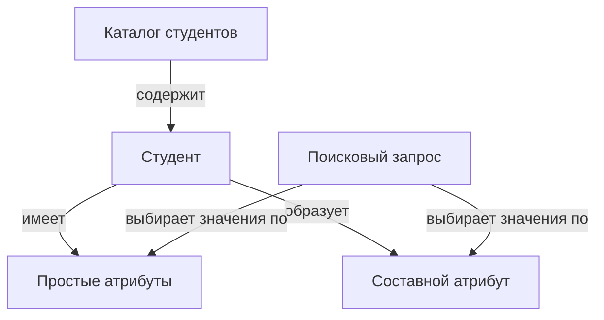
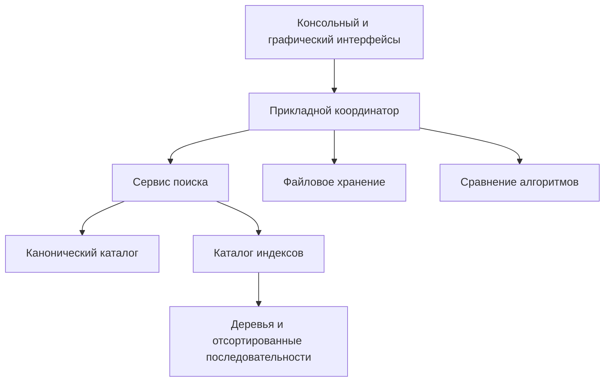
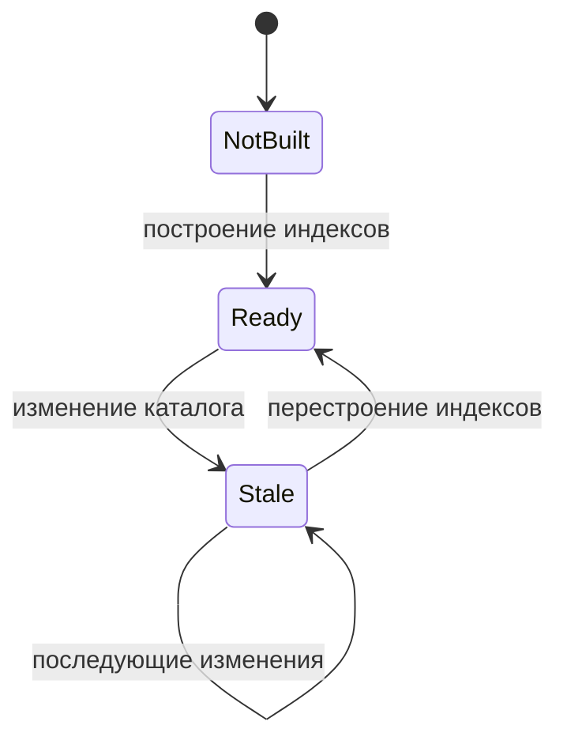

## 2. Постановка задачи

Необходимо спроектировать программу для хранения набора записей о студентах, выборочного построения индексов по зарегистрированным атрибутам и выполнения поиска несколькими алгоритмами. Программа должна позволять проверить корректность алгоритмов вручную и автоматически, измерить их производительность на одинаковых данных и выгрузить результаты измерений в открытом формате.

Исходные записи должны оставаться в каноническом хранилище в порядке добавления. Для ускорения поиска рядом с ними создаются отдельные производные структуры — индексы. Построение индексов не должно переставлять исходные записи.

### 2.1. Выбранная конфигурация задания

| Пункт | Код | Баллы |
|---|---:|---:|
| Индексирование данных | `И-5` | 7 |
| Поиск по диапазону значений | `И-5.1` | 5 |
| Индексирование составных атрибутов | `И-5.2` | 7 |
| Бинарное дерево | `М-3` | 15 |
| `IDictionary` на бинарном дереве | строка `IDictionary`, столбец «Бинарное дерево» | 5 |
| `ISortedSequence` на последовательности | строка `ISortedSequence`, столбец `Sequence` | 3 |
| Бинарный поиск по отсортированной последовательности | `М-2` | 10 |
| Хранение в структурированном текстовом или бинарном файле | `О-2` | 10 |
| **Итого** |  | **62** |

### 2.2. Цели решения

1. Обеспечить хранение корректного набора записей о студентах.
2. Поддержать точный поиск по простым и составному атрибутам.
3. Поддержать поиск по включительному диапазону значений.
4. Реализовать и сравнить линейный, древесный и бинарный поиск там, где они применимы.
5. Реализовать `IDictionary` на основе бинарного дерева поиска.
6. Реализовать `ISortedSequence` на основе собственной последовательности.
7. Сохранять и восстанавливать исходные записи в структурированном текстовом формате.
8. Предоставить консольный и графический пользовательские интерфейсы поверх одной прикладной логики.
9. Обеспечить воспроизводимое измерение производительности и экспорт результатов в CSV.


## 3. Предметная область

### 3.1. Понятия предметной области

#### Студент

Студент — информационная запись со следующими атрибутами:

- `ID` — устойчивый уникальный идентификатор;
- имя;
- фамилия;
- год рождения;
- средний балл (`GPA`).

`ID` отличает записи даже тогда, когда все остальные атрибуты совпадают.

#### Каталог студентов

Каталог студентов — набор записей, над которым выполняются операции загрузки, просмотра, добавления и поиска. Каталог является единственным источником полных данных о студентах.

#### Простой атрибут поиска

Простой атрибут поиска — одно поле студента, используемое как ключ. В решении используются:

- `ID`;
- фамилия;
- год рождения;
- `GPA`.

#### Составной атрибут поиска

Составной атрибут образуется из трех полей:

1. фамилия;
2. имя;
3. год рождения.

Он сравнивается лексикографически: сначала по фамилии, затем при равенстве фамилий по имени, затем при равенстве фамилии и имени по году рождения.

#### Поисковый запрос

Поисковый запрос задает атрибут, способ поиска и искомое значение. Запрос бывает:

- точным — требуется найти записи с ключом, равным заданному;
- диапазонным — требуется найти записи, ключи которых входят в замкнутый диапазон от нижней до верхней границы.

### 3.2. Связи понятий



Основные связи:

- каталог содержит ноль или более студентов;
- каждый студент принадлежит одному текущему каталогу;
- `ID` однозначно определяет студента в пределах каталога;
- одна фамилия, один год рождения, один `GPA` или один составной ключ могут относиться к нескольким студентам;
- результат запроса является подмножеством записей текущего каталога.

### 3.3. Инварианты предметных данных

1. В каталоге не может быть двух записей с одинаковым `ID`.
2. `GPA` должен быть конечным числом; `NaN` и бесконечности недопустимы.
3. Пустой каталог является корректным состоянием.
4. Отсутствие совпадений является корректным результатом поиска, а не ошибкой.
5. Нижняя граница корректного диапазона не должна быть больше верхней согласно выбранному компаратору.
6. Полные данные студента хранятся только в каталоге; вспомогательные структуры ссылаются на записи через `ID` либо позицию.

## 4. Дизайн решения

### 4.1. Основные принципы

1. **Один источник истины.** Полные записи находятся в каноническом хранилище, а индексы являются производными данными.
2. **Разделение данных и способов поиска.** Один набор записей используется всеми сравниваемыми алгоритмами.
3. **Неизменность исходного порядка.** Для бинарного поиска создается отдельное отсортированное представление; исходный каталог не сортируется.
4. **Реестр индексов.** Предусмотрен начальный набор атрибутов; каждый индекс описывается извлечением ключа, порядком сравнения и структурой хранения.
5. **Проверяемая эквивалентность.** Перед учетом времени результаты разных стратегий сравниваются полностью.
6. **Детерминированный порядок результата.** Совпадения упорядочиваются по ключу, а при равных ключах — по `ID`.
7. **Безопасное обновление состояния.** Неуспешная загрузка или подготовка новых данных не должна повреждать текущий каталог.
8. **Общая прикладная логика.** Консольный и графический интерфейсы выполняют одни и те же сценарии через общий прикладной слой.

### 4.2. Архитектура компонентов



#### Пользовательские интерфейсы

Отвечают за ввод параметров, отображение исходных записей, результатов, статистики и ошибок. Бизнес-правила и алгоритмы поиска в интерфейсах не дублируются.

#### Прикладной координатор

Объединяет пользовательские сценарии: добавление и генерацию данных, загрузку и сохранение, построение индексов, поиск, запуск сравнения и экспорт результатов. Хранит последние успешно полученные результаты сравнения до их замены новым успешным запуском.

#### Сервис поиска

Предоставляет единый способ выполнения точных и диапазонных запросов. Выбирает линейную, древесную или бинарную стратегию, но возвращает результат в одном формате — последовательность ссылок на записи текущего снимка.

#### Канонический каталог

Владеет полными записями и сохраняет их исходный порядок. Позиция в снимке обеспечивает прямой доступ к найденной записи. Постоянное вспомогательное соответствие `ID` &rarr; `позиция` не требуется; уникальность проверяется при добавлении или замене данных. Любое изменение набора данных переводит ранее построенные индексы в неактуальное состояние.

#### Каталог индексов

Хранит реестр древесных и отсортированных индексов. Пользователь явно выбирает сочетания атрибута и структуры для построения. Каждый индекс имеет собственное состояние и идентификатор снимка. Изменение данных делает ранее построенные индексы устаревшими; перестроение выбранного не обновляет остальные. Неуспешное построение сохраняет прежние состояния всех индексов.

#### Файловое хранение

Преобразует канонические записи в версионированный текстовый формат и обратно. Индексы не сохраняются, поскольку могут быть однозначно восстановлены из исходных данных.

#### Подсистема сравнения

Готовит одинаковые наборы данных и запросов, проверяет совпадение результатов, измеряет построение и поиск, агрегирует измерения и сохраняет их в CSV.

#### Единая обработка ошибок

Все ожидаемые ошибки имеют общий код, сообщение, подсказку и дополнительный контекст: поле, путь, строку файла и технические подробности. Слои передают ошибку выше без потери контекста, а интерфейс отвечает только за ее форматирование и показ.

### 4.3. Жизненный цикл данных и индексов

У каждого индекса есть три наблюдаемых состояния:



- **Не построен:** поиск через этот индекс недоступен, линейный доступен.
- **Актуален:** индекс соответствует текущему снимку данных.
- **Устарел:** каталог изменился после построения; поиск через этот индекс отклоняется до его перестроения.

Актуальность определяется идентификатором снимка каталога. При каждой содержательной замене данных создается новый идентификатор, а каждый построенный индекс запоминает идентификатор использованного снимка. В одном реестре могут одновременно находиться актуальные, устаревшие и еще не построенные индексы.

Загрузка является отдельным сценарием: файл полностью читается и проверяется во временном состоянии, затем для него строятся индексы, и только после общего успеха новое состояние заменяет текущее.

### 4.4. Базовые структуры данных

Алгоритмическое ядро повторно использует разработанные в ЛР-1:

- динамический массив как базовую последовательность;
- несбалансированное бинарное дерево поиска;
- модель студента и ее потоковое представление.

Дерево и последовательность параметризуются типами значений и компараторами.

#### `IDictionary` на бинарном дереве

Словарь хранит уникальные ключи и соответствующие значения. Он предоставляет:

- количество элементов и сведения о вместимости;
- проверку наличия ключа;
- получение значения;
- добавление, обновление и удаление;
- получение ключей и значений;
- очистку.

Поиск, вставка и удаление имеют сложность `O(h)`, где `h` — высота дерева. Поскольку дерево не балансируется, средняя ожидаемая сложность на случайном порядке близка к `O(log N)`, а худшая — `O(N)`.

#### `ISortedSequence` на последовательности

Отсортированная последовательность хранит элементы в динамическом массиве и поддерживает порядок после каждого добавления. Позиция вставки определяется бинарной границей, затем элементы правее нее сдвигаются.

Последовательность предоставляет:

- длину и признак пустоты;
- доступ по позиции, к первому и последнему элементам;
- поиск позиции элемента;
- получение подпоследовательности;
- добавление и очистку.

Поиск позиции вставки занимает `O(log N)`, а сдвиг элементов — `O(N)`. Это осознанный компромисс: построение дороже, но поиск по готовой последовательности использует бинарный алгоритм.

### 4.5. Схема индексов

Для каждой стратегии создается отдельное представление одних и тех же данных.

| Атрибут | Значение ключа | Значение в обоих словарях |
|---|---|---|
| `ID` | устойчивый идентификатор | группа ссылок на записи (не более одной) |
| Фамилия | фамилия | группа ссылок на записи |
| Год рождения | год | группа ссылок на записи |
| `GPA` | средний балл | группа ссылок на записи |
| Составной ключ | фамилия, имя, год | группа ссылок на записи |

Ссылка содержит позицию записи, ее `ID` и идентификатор снимка. Проверка снимка предшествует обращению по позиции. Поэтому после добавления или замены данных прежняя ссылка не может незаметно указать на другую запись.

Один обобщённый индекс извлекает ключ и формирует группы ссылок. Поисковый интерфейс параметризуется типом ключа: индекс принимает значение своего типа напрямую. Общий интерфейс построения, состояния и копирования позволяет хранить разнородные индексы в одном реестре; тип поискового интерфейса проверяется при выборе индекса. Физическое хранение передаётся словарю с общим контрактом: на бинарном дереве либо на отсортированной последовательности. Группы поддерживаются в порядке `ID`. Диапазонный поиск является отдельной возможностью словаря; древесный словарь ее не предоставляет.

### 4.6. Алгоритмы поиска

#### Линейный поиск

Линейная стратегия последовательно проверяет все записи канонического каталога. Она не требует построенных индексов и служит одновременно рабочим алгоритмом и эталоном для автоматической проверки индексированных стратегий.

Сложность — `O(N)` без учета упорядочивания результата.

#### Точный поиск в дереве

Древесная стратегия обращается к выбранному словарю и получает группу ссылок на записи. Для уникального `ID` группа содержит не более одной ссылки.

Сложность поиска — `O(h + K)`, где `K` — число найденных записей.

#### Бинарный поиск

Для отсортированной последовательности определены общие операции:

- `lower bound` — первая позиция с ключом, не меньшим заданного;
- `upper bound` — первая позиция с ключом, большим заданного;
- точный бинарный поиск;
- диапазон эквивалентных элементов.

Один универсальный алгоритм поиска точки разделения используется как основа обеих границ. Сравнение выполняется через переданный компаратор, а ключ извлекается из элемента отдельной операцией. Это позволяет применять один алгоритм к значениям и к индексным записям.

Точный поиск находит уникальный ключ в отсортированном словаре бинарным алгоритмом и возвращает соответствующую группу ссылок. Сложность — `O(log M + K)`, где `M` — число различных ключей, `K` — число совпадений.

#### Диапазонный поиск

Диапазон по значениям является включительным: `[lower, upper]`. В отсортированном индексе ему соответствует полуинтервал позиций:

```text
[lowerBound(lower), upperBound(upper))
```

Поэтому элементы, равные обеим границам, включаются в результат. Сложность — `O(log N + K)`.

Диапазонный поиск поддерживается для:

- года рождения;
- `GPA`;
- составного ключа.

Для составного ключа диапазон является единым лексикографическим интервалом, а не тремя независимыми диапазонами. Например, при одинаковой фамилии сначала ограничивается область имен, а год уточняет порядок только при совпадении фамилии и имени.

### 4.7. Нормализация результатов

Все стратегии возвращают ссылки на записи снимка. Полные записи разрешаются по позиции только на границе отображения результата, с проверкой снимка и `ID`; выдача K полных записей занимает `O(K)`. Для сравнения алгоритмов из ссылок извлекается последовательность `ID`.

Для возможности полного сравнения результаты нормализуются:

- точные совпадения упорядочиваются по `ID`;
- диапазонные совпадения — по ключу, затем по `ID`;
- дубликаты одной записи в одном результате не допускаются.

### 4.8. Структурированное файловое хранение

Используется человекочитаемый версионированный текстовый формат:

```text
DOR2_STUDENT_DATA 1
2
101:"Ivan":"Ivanov":2003:4.8
102:"Anna":"Petrova":2002:4.5
```

Первая строка содержит сигнатуру и версию, вторая — заявленное число записей, остальные строки — записи студентов.

При загрузке проверяются:

- сигнатура и версия;
- корректность количества записей;
- синтаксис каждой записи;
- уникальность `ID`;
- конечность `GPA`;
- отсутствие лишних непробельных данных.

Ошибка содержит путь и номер строки, если он известен. Неуспешная загрузка не изменяет текущий каталог.

При сохранении данные сначала записываются во временный файл. Целевой файл заменяется только после успешной записи и закрытия потока. Индексы в файл не включаются.

### 4.9. Обработка ошибок

Ожидаемые ошибки возвращаются как значения и имеют единый формат. Каталог ошибок содержит стабильный код, пользовательское сообщение и подсказку по исправлению. Контекст конкретного случая может включать:

- имя поля;
- путь к файлу;
- номер строки;
- технические подробности.

К ожидаемым ошибкам относятся дублирующийся `ID`, неверное число, некорректный диапазон, неактуальный индекс, ошибка формата и невозможность файловой операции.

Исключения предназначены для нарушения внутренних инвариантов и других неожиданных ситуаций. Они перехватываются на границе выполнения пользовательской команды и преобразуются в единое сообщение о непредвиденной ошибке.

### 4.10. Пользовательские интерфейсы

Консольный и графический интерфейсы поддерживают одинаковые прикладные возможности. Единое описание атрибута задает название, извлечение ключа, поля ввода, разбор значений, доступность диапазона и подсказку. Из него формируются реестр поисковых операций, списки атрибутов и формы обоих интерфейсов. Запрос содержит последовательности значений нижнего и верхнего ключа; число полей проверяется до разбора. Диспетчер и интерфейсы не содержат отдельных ветвей для каждого атрибута.

Статистика строится по реестру индексов и включает построенные, не построенные и устаревшие состояния. Добавление нового атрибута не требует добавления отдельных полей статистики.

Графический интерфейс выполняет длительные операции в одном рабочем потоке. В каждый момент времени активна не более чем одна операция. Пока она выполняется, конфликтующие действия блокируются, а интерфейс продолжает обрабатывать события.

Рабочий поток не изменяет данные одновременно с чтением из интерфейса. После завершения он передает готовый снимок отображаемого состояния: записи, результаты сравнения, статистику и состояние индексов.

### 4.11. Сравнение производительности

Сравнение строится по следующим правилам:

1. Для всех алгоритмов используется один набор данных.
2. Наборы точных и диапазонных запросов создаются один раз.
3. Рассматриваются возрастающий, убывающий и псевдослучайный порядок входа.
4. Для дерева и отсортированной последовательности отдельно измеряется построение.
5. Для точного поиска сравниваются линейная, древесная и бинарная стратегии.
6. Для диапазонного поиска сравниваются линейная и бинарная стратегии.
7. До измерения результаты стратегий проверяются на полное равенство.
8. Выполняется прогрев, затем несколько повторов; итогом является медиана.
9. Параметры генерации определяются размером, числом запросов и `seed`.
10. Результаты сохраняются в CSV вместе с признаком успешной проверки.

Сравнение времени построения особенно важно для несбалансированного дерева: на уже отсортированном входе оно может выродиться, поэтому измерение только поиска в готовой структуре не отражает стоимость метода.

## 5. Функциональные требования

### 5.1. Управление данными

- Система должна позволять добавить студента вручную.
- Система должна отклонять повторяющийся `ID` без изменения каталога.
- Система должна отклонять неконечный `GPA`.
- Система должна генерировать воспроизводимый набор заданного размера по `seed`.
- Система должна позволять просмотреть исходные записи в их каноническом порядке.
- Замена набора должна происходить целиком: частично проверенные данные не становятся текущими.

### 5.2. Индексирование

- Система должна строить древесные и отсортированные индексы по зарегистрированным описаниям.
- Должны поддерживаться индексы по `ID`, фамилии, году рождения, `GPA` и составному ключу.
- Построение индексов не должно менять порядок исходных записей.
- После изменения данных ранее построенные индексы должны считаться устаревшими.
- Использование отсутствующего или устаревшего индекса должно возвращать понятную ошибку.
- Пользователь должен иметь возможность выбрать сочетания атрибутов и структур для построения и просмотреть состояние и статистику каждого индекса.

### 5.3. Точный поиск

- Должен поддерживаться точный поиск по `ID`, фамилии, году рождения, `GPA` и составному ключу.
- Пользователь должен иметь возможность выбрать линейную, древесную или бинарную стратегию.
- Линейная стратегия должна работать без построенных индексов.
- Индексированные стратегии должны отклонять запрос при неактуальных индексах.
- Все стратегии должны возвращать семантически и порядково одинаковый результат.
- Отсутствие совпадений должно возвращать пустой успешный результат.

### 5.4. Диапазонный поиск

- Должен поддерживаться включительный диапазонный поиск по году рождения, `GPA` и составному ключу.
- Пользователь должен иметь возможность выбрать линейную или бинарную стратегию.
- Обратный диапазон должен отклоняться как некорректный.
- Пустой результат корректного диапазона не должен считаться ошибкой.
- Линейная и бинарная стратегии должны возвращать одинаково упорядоченный результат.
- Границы диапазона должны входить в результат.

### 5.5. Файловые операции

- Система должна загружать записи из поддерживаемого структурированного текстового формата.
- Система должна сохранять текущие записи в этом формате.
- Загрузка должна проверять версию, число записей, формат полей, уникальность `ID` и лишние данные.
- Ошибка загрузки не должна изменять текущие данные.
- После успешной загрузки индексы должны быть построены для нового набора.
- Сохранение не должно оставлять целевой файл частично записанным при обнаруженной ошибке записи.

### 5.6. Сравнение алгоритмов

- Система должна измерять построение структур, точный и диапазонный поиск.
- Сравниваемые алгоритмы должны получать одинаковые данные и запросы.
- Должны исследоваться возрастающий, убывающий и случайный порядок входных данных.
- Результаты алгоритмов должны проверяться до признания измерения корректным.
- Повторный запуск с тем же `seed` должен воспроизводить данные и запросы.
- Результаты должны экспортироваться в CSV.
- По CSV должна быть возможность построить графики построения, точного и диапазонного поиска.
- Неуспешный новый запуск не должен уничтожать предыдущий успешный результат.

### 5.7. Пользовательский интерфейс

- Должны быть доступны ручной ввод и автоматическая генерация данных.
- Пользователь должен видеть исходные записи и результаты запросов.
- Пользователь должен выбирать атрибут, вид и стратегию поиска.
- Пользователь должен видеть количество записей и состояние индексов.
- Ошибки должны отображаться вместе с доступным контекстом и подсказкой.
- Консольный и графический интерфейсы должны использовать общие прикладные сценарии.
- Графический интерфейс не должен блокировать обработку событий во время длительной операции.
- При закрытии с несохраненными данными должно выводиться предупреждение.

## 6. Нефункциональные требования

### 6.1. Корректность

- Основные структуры и алгоритмы должны быть покрыты модульными тестами.
- Интеграционные тесты должны проверять полный цикл загрузки, построения индексов, поиска и сохранения.
- Должны проверяться пустые структуры, одинаковые ключи, отсутствующие значения, граничные и некорректные диапазоны.
- Автоматическая проверка сравнения должна учитывать полные последовательности `ID`, а не только количество совпадений.

### 6.2. Производительность

- Линейный просмотр должен иметь сложность `O(N)`; детерминированное упорядочивание K совпадений может занимать дополнительно `O(K log K)`.
- Бинарная граница должна находиться за `O(log N)`.
- Выдача `K` совпадений после бинарной границы должна занимать `O(K)`.
- Операции дерева должны зависеть от его высоты `h`.
- Отладочный вывод, подготовка данных и проверка результатов не должны входить в измеряемый интервал поиска.

### 6.3. Надежность

- Владение ресурсами должно основываться на RAII.
- Копирование и перемещение структур не должны приводить к совместному изменяемому владению логически независимыми данными.
- Неуспешные составные операции должны сохранять предыдущее корректное состояние.
- Сборка с AddressSanitizer и UndefinedBehaviorSanitizer не должна выявлять ошибок памяти и неопределенного поведения.

### 6.4. Воспроизводимость и переносимость

- Генераторы данных и запросов должны принимать явный `seed`.
- Формат файлов и чисел должен использовать стабильную классическую локаль и точку как десятичный разделитель.
- Сборка должна быть описана средствами CMake.
- Алгоритмическое ядро должно использовать C++23 и повторно подключать структуры ЛР-1 без изменения их поведения.

### 6.5. Понятность

- Имена компонентов и операций должны отражать назначение, структуру хранения и стратегию поиска.
- Общие структуры и алгоритмы должны быть параметризованы типами и компараторами там, где это устраняет дублирование.
- Предметный слой должен оставаться ориентированным на студентов и не превращаться в неоправданно универсальный фреймворк.
- Решения по владению, актуальности индексов, границам диапазона и порядку результата должны быть объяснимы отдельно от деталей исходного кода.

## 7. Соответствие выбранным пунктам задания

| Пункт | Проектное решение |
|---|---|
| `И-5` | Реестр выбираемых древесных и отсортированных индексов над каноническим каталогом студентов |
| `И-5.1` | Включительный диапазонный поиск по году, `GPA` и составному ключу |
| `И-5.2` | Лексикографический ключ «фамилия, имя, год рождения» |
| `М-3` | Несбалансированное шаблонное бинарное дерево из ЛР-1 |
| `IDictionary` на дереве | Шаблонный словарь уникальных ключей поверх бинарного дерева |
| `ISortedSequence` на `Sequence` | Отсортированная последовательность поверх собственного динамического массива |
| `М-2` | Самостоятельные бинарные границы, точный поиск и поиск групп эквивалентных ключей |
| `О-2` | Версионированный структурированный текстовый формат с проверяемой загрузкой и безопасным сохранением |
